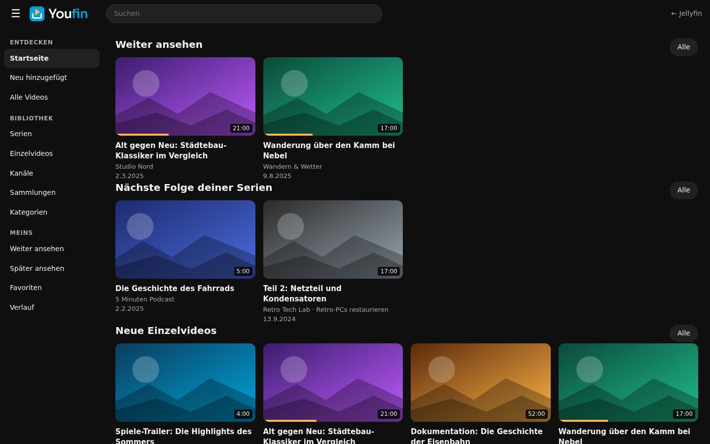
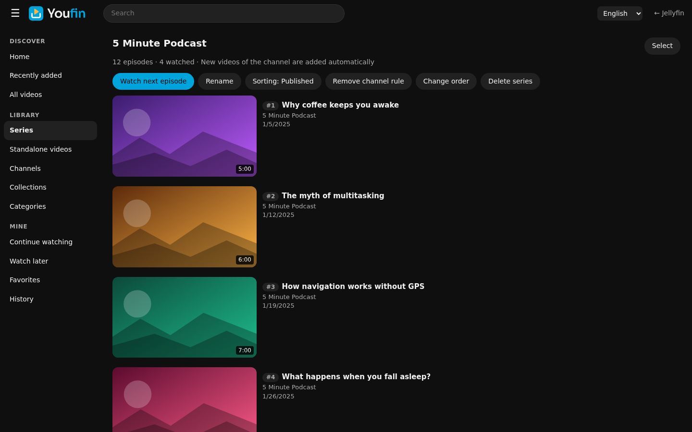
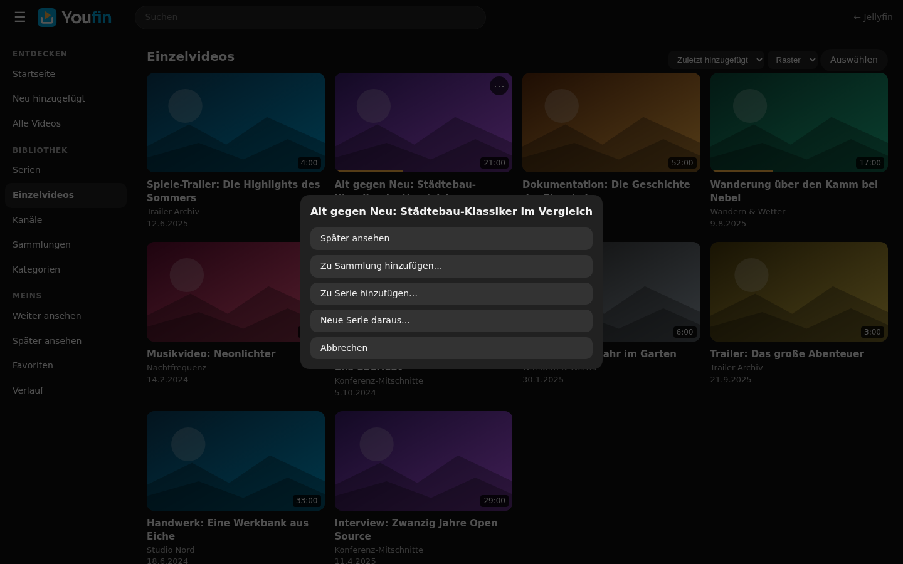
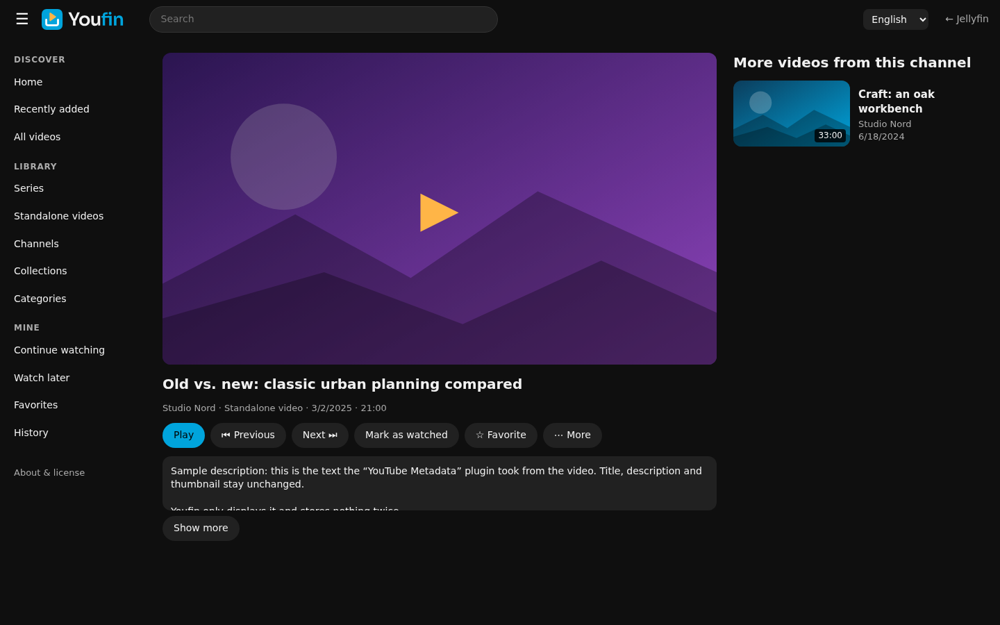
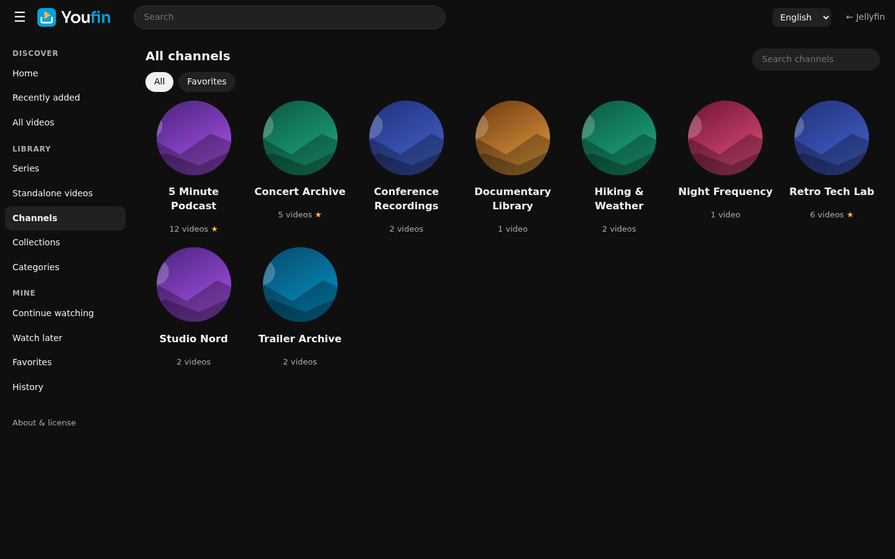

<p align="center">
  <picture>
    <source media="(prefers-color-scheme: dark)" srcset="assets/logo-dark.svg">
    
  </picture>
</p>

<h3 align="center">Dein privates Offline-YouTube für Jellyfin.</h3>

<p align="center">
  Aus heruntergeladenen YouTube-Videos wird eine Bibliothek, die sich anfühlt wie YouTube:<br>
  Kanäle, Serien, Einzelvideos, Sammlungen und Suche. Lokal, ohne Algorithmus, ohne Internet.
</p>

<p align="center">
  <a href="https://github.com/brewing8309/Youfin/actions/workflows/build.yml"></a>
  
  
  
  <a href="LICENSE"></a>
</p>

<p align="center">
  
</p>

> Die Screenshots zeigen Demo-Daten.

## Warum Youfin?

Heruntergeladene YouTube-Videos passen nicht gut in die Jellyfin-Struktur aus Filmen und Serien. Mal ist es ein kompletter Kanal, mal ein einzelnes Video, das man einfach archivieren will. Youfin gibt beidem einen Platz, ohne dass du künstliche Serien anlegen musst.

- **Nutzt, was schon da ist.** Titel, Beschreibung, Vorschaubild und Datum kommen aus Jellyfin bzw. dem Plugin *YouTube Metadata*. Youfin lädt nichts herunter und überschreibt nichts.
- **Einzelvideos sind vollwertig.** Ein Video braucht weder Serie noch Kanal-Sammlung, um in der Bibliothek zu glänzen.
- **Mehrbenutzerfähig.** Weiter ansehen, Favoriten und Sammlungen sind pro Nutzer getrennt.
- **Schnell.** Der Index liegt im Speicher, Listen laden seitenweise. Getestet mit 20.000 Videos.

## Funktionen

| | |
|---|---|
| **Startseite** | Weiter ansehen, nächste Folge deiner Serien, neue Einzelvideos, Später ansehen, Meine Kanäle, Aus dem Archiv |
| **Kanäle** | Automatisch erkannt (Kanal-ID, sonst Name), Favoriten, Umbenennen und Zusammenführen ohne die Original-Metadaten zu ändern |
| **Serien** | Geordnete Reihen über Kanalgrenzen hinweg, optional mit Kanalregel (neue Videos kommen automatisch dazu), Fortschritt und „Nächste Folge“ |
| **Einzelvideos** | Alles, was keiner Serie angehört, mit eigener Übersicht |
| **Sammlungen** | Freie Gruppierungen pro Nutzer, manuell sortierbar, inklusive „Später ansehen“ |
| **Suche** | Titel, Kanal, Beschreibung, YouTube-ID, Tags und Kategorien |
| **Verwaltung** | Über das ⋯-Menü und die Mehrfachauswahl: Serie zuweisen, als Einzelvideo kennzeichnen, in Sammlung legen |
| **Wiedergabe** | Mit dem nativen Jellyfin-Player, Fortschritt und „Gesehen“ bleiben in Jellyfin |

<table>
  <tr>
    <td></td>
    <td></td>
  </tr>
  <tr>
    <td></td>
    <td></td>
  </tr>
</table>

## Das Konzept

| Konzept | Bedeutung |
|---|---|
| **Kanal** | Herkunft des Videos, automatisch erkannt. Bleibt immer als Metadatum erhalten. |
| **Serie** | Kuratierte, geordnete Reihe. Ein Video gehört zu höchstens einer Serie. |
| **Sammlung** | Deine freie Gruppierung. Ein Video kann in mehreren liegen. |
| **Einzelvideo** | Ein Video ohne Serie. Das ist der Normalfall für neue Videos. |

Mehr dazu in [docs/ORGANISATION.md](docs/ORGANISATION.md).

## Installation

**Voraussetzung:** Jellyfin 12.4 (.NET 10).

**Über das Plugin-Repository** (sobald dieses Repository öffentlich ist):
1. Jellyfin → Dashboard → Plugins → Repositories → hinzufügen: `https://raw.githubusercontent.com/brewing8309/Youfin/main/manifest.json`
2. Im Katalog *Youfin* installieren und Jellyfin neu starten.

**Manuell:**
1. `youfin_0.1.0.0.zip` aus den [Releases](https://github.com/brewing8309/Youfin/releases) laden und die DLL nach `<Jellyfin-Datenordner>/plugins/Youfin_0.1.0.0/` kopieren.
2. Jellyfin neu starten.

**Öffnen:** `https://<dein-server>/Youfin/Web/` im Browser, in dem du bei Jellyfin angemeldet bist.

Für einen Eintrag in der Jellyfin-Seitenleiste trägst du in `jellyfin-web/config.json` ein:

```json
"menuLinks": [{ "name": "Youfin", "icon": "smart_display", "url": "/Youfin/Web/" }]
```

Mehr Details und Updates: [docs/INSTALL.md](docs/INSTALL.md).

## FireTV, Swiftfin und Infuse

Diese Apps zeigen keine Plugin-Seiten. Youfin legt deshalb auf Wunsch **pro Serie eine Jellyfin-Collection** an (optional auch pro Kanal), die dort wie ein normales Album erscheint.

Dashboard → Plugins → Youfin → *Pro Serie eine Collection anlegen* aktivieren, danach die Aufgabe *Youfin: Serien-Collections synchronisieren* ausführen. Sie läuft anschließend täglich.

## So funktioniert es

```
 Jellyfin-Bibliothek ──► Scanner (nur lesend) ──► Index im Speicher ◄── state.json (nur deine Zuordnungen)
   Titel, Bilder, Daten         Kanal-ID, Video-ID            │
   YouTube Metadata, info.json                                ▼
                                                  Web-Oberfläche  /Youfin/Web/
                                                  Collections für FireTV, Swiftfin, Infuse
```

- Video-ID aus `YoutubeMetadata` oder dem Dateinamen (`[ID]`), Kanal aus der Jellyfin-Person, der Serie oder der `.info.json`, zuletzt aus dem Ordnernamen.
- Gespeichert wird nur, was Jellyfin nicht kennt: Serien, Zuordnungen, Kanal-Aliase, Favoriten und Sammlungen. Das passiert in `state.json` im Plugin-Datenordner und übersteht Updates.
- Das Plugin läuft auch ohne *YouTube Metadata* und ohne `.info.json`. Dann greifen Dateiname und Ordnername.

Architektur und Entscheidungen: [docs/ARCHITECTURE.md](docs/ARCHITECTURE.md).

## Entwicklung

```bash
dotnet test                                          # Unit-Tests
dotnet build -c Release src/Jellyfin.Plugin.Youfin   # Plugin bauen
```

Das Plugin ist in C# (.NET 10) gegen `Jellyfin.Controller` 12.4 geschrieben, die Oberfläche ist reines JavaScript ohne Build-Schritt (`src/Jellyfin.Plugin.Youfin/Web/app`). Die Markenelemente liegen einmal in [`assets/`](assets) und werden ins Plugin eingebettet.

## Roadmap

- [x] Kanäle, Suche, Favoriten, Playlists
- [x] Serien, Einzelvideos, Sammlungen, Mehrfachauswahl
- [x] Collection-Sync für FireTV, Swiftfin und Infuse
- [ ] Automatische Serienvorschläge (Titelmuster, Playlist-Felder der `.info.json`)
- [ ] Kategorien manuell vergeben
- [ ] Mehr als 200 Folgen pro Serie in der Reihenfolge-Ansicht

## Danksagung und Hinweise

- [Jellyfin](https://jellyfin.org) und das Plugin [YouTube Metadata](https://github.com/ankenyr/jellyfin-youtube-metadata-plugin) von ankenyr, auf dem diese Bibliothek aufbaut.
- Schrift im Logo: [Sora](https://github.com/sora-xor/sora-font) (SIL Open Font License 1.1).
- Youfin ist ein unabhängiges Community-Projekt und steht in keiner Verbindung zu YouTube, Google oder dem Jellyfin-Projekt. YouTube ist eine Marke von Google LLC. Youfin lädt keine Videos herunter, es verwaltet nur Dateien, die du bereits besitzt. Beachte die Nutzungsbedingungen und das Urheberrecht beim Herunterladen.

## Lizenz

[PolyForm Noncommercial 1.0.0](LICENSE): Nutzen, ändern und weitergeben ist erlaubt, **aber nicht, um damit Geld zu verdienen**.

Zusätzlich ist in der [LICENSE](LICENSE) als „Required Notice“ festgehalten, was bei jeder Nutzung, Kopie oder Weitergabe (auch von Teilen) mitgegeben werden muss:

- der Hinweis, dass Youfin **mit KI erstellt** wurde (Claude Code von Anthropic),
- der **Verweis auf dieses Repository**: <https://github.com/brewing8309/Youfin>

> Youfin ist damit „source-available“, aber keine Open-Source-Lizenz im Sinne der OSI.
